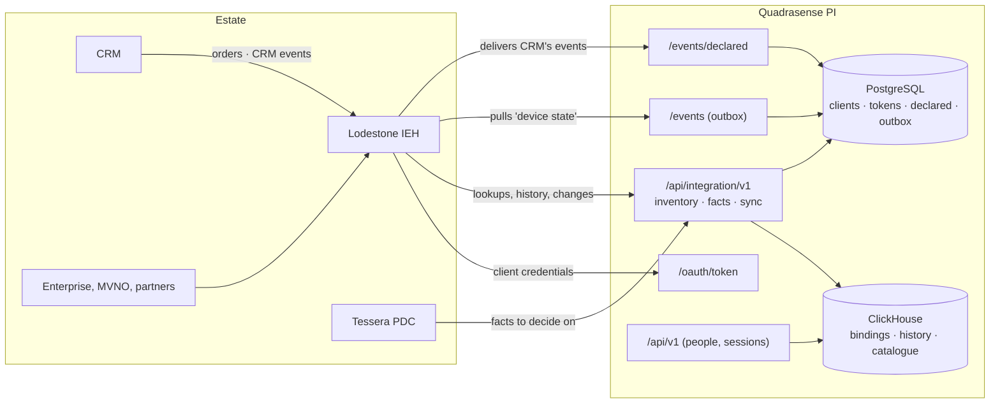

# PI integration API: architecture

**Status:** 2026-11-09. The decisions and what was rejected are in ADR-024; the endpoints in
`PI-API-CATALOG.md`; who uses what in `PI-INTEGRATION-MATRIX.md`.

## 1. Where it sits



- **Lodestone is the door.** PI registers Lodestone - and Tessera, where it reads facts directly, as v6
  draws - never a partner. A partner's tenancy, quotas and contracts are Lodestone's (doc 20 §3).
- **Two APIs, two credentials, no crossing.** The UI's `/api/v1` takes a person's session; the integration
  API's `/api/integration/v1` takes a system's bearer token. A session opens no integration route and a
  token opens no UI route: the bearer scheme is never the default, and the integration policies name only it
  (`EndpointAuthorizationTests` holds every integration route to that).
- **PI opens no connection.** Everything is called *into* PI, so the only network request is ingress (MCI
  red lines, §1-4 row 4: egress has to be requested for each destination).

## 2. Authentication: OAuth 2.0 client credentials, issued by PI

```mermaid
sequenceDiagram
    participant L as Lodestone
    participant P as PI
    participant DB as PostgreSQL
    L->>P: POST /oauth/token (Basic client_id:secret, grant_type=client_credentials)
    P->>DB: client by id; SHA-256(secret) = stored hash? active? scopes held?
    P->>DB: insert SHA-256(token), scopes, expires_at = now + 15 min
    P-->>L: { access_token, token_type: Bearer, expires_in: 900, scope }
    L->>P: POST /inventory/lookup (Authorization: Bearer token)
    P->>DB: token by SHA-256, unexpired, client active
    P-->>L: 200, or 401 invalid_token, or 403 insufficient_scope
```

| Property | How |
|---|---|
| Secrets | 32 random bytes, shown once to the administrator; only SHA-256 stored (red lines §2-3 row 8). A plain hash is enough at 256 bits of entropy; Argon2id is for passwords people choose |
| Tokens | 32 random bytes, opaque, 15 minutes, stored as SHA-256 and looked up per request, as sessions are. Not JWTs: revocation is immediate, and nothing can be read from a leaked token |
| Revocation | Deactivating a client or rotating its secret deletes its tokens in the same transaction; a deactivated client's tokens are refused by the lookup's join meanwhile |
| Unknown client | Hashed against a throwaway value, so it costs what a known one does; answered `invalid_client` like a wrong secret |
| Brute force | 30 token requests a minute per address, before anything runs; every refusal audited by client id, never by secret |
| Transport | HTTPS from MCI's internal CA at the ingress (red lines §2-1 row 8); mTLS is an ingress setting if Lodestone or MCI asks for it (matrix D4) |

## 3. Authorisation: scopes, then masking

A scope is to a system what a permission is to a person, and kept apart from permissions on purpose: a
policy for one must never be satisfied by the other. Each route names one scope; `/status` needs only an
authenticated client.

| Scope | Routes |
|---|---|
| `inventory.read` | lookup, batch, relationships, history, device model |
| `inventory.sync` | changes |
| `facts.read` | facts |
| `events.read` / `events.write` | the feed / declared events |
| `quality.read` | quality feed and signals |
| `identifiers.reveal` | none: decides masking |

**Masking** is the UI's rule carried over: `identifier.reveal` decides complete identifiers for a person,
`identifiers.reveal` for a system. Without it, every IMSI, ICCID, IMEI and number in an answer is masked by
`IdentifierMask`, but the identifier the client sent - and, for an ICCID, the SIM it names - because masking
something back to the caller who supplied it protects nothing. A sync feed has no "sent" identifier, so a
client keeping a copy needs the scope; that is deliberate.

**No key values exist to leak.** PI holds key references at most, and today not even those (CLAUDE.md,
2026-11-02). `No_integration_contract_can_carry_a_key_value` fails if any integration contract gains a
field named like a key (Ki, OPc, K4, OP, KIc, KID, KIK, transport key).

## 4. Reads: the UI's reads, not a second copy

| Route | Reads through | Store |
|---|---|---|
| lookup, batch, history, facts (bindings) | `ITimelineStore` + `TimelineBuilder`, as the Explorer's timeline | ClickHouse `binding_history*` |
| relationships | `IDeviceAnalyticsStore.GetRelationshipsAsync`, as the relationship explorer | ClickHouse |
| device model, facts (models) | `IDeviceAnalyticsStore.GetDeviceAsync`, as the device page | ClickHouse catalogue |
| facts (risk) | `RiskEndpoints.AssessAsync`, extracted from the risk page's entity route | ClickHouse risk snapshot |
| changes | `IBindingChangeReader` (new): one day's partition of `binding_event`, keyset-paged | ClickHouse |
| quality | `QualityQueries`, as the Data quality page | ClickHouse |
| declared events | `IDeclaredEventStore` (new) | PostgreSQL |

Lookups, history and facts answer `503` while the binding history is being built: an answer from an
incomplete history would miss days without saying so.

**Identifiers are always in bodies** (red lines §2-3 row 7). The sync cursor is the last row's key, so the
changes route is a `POST` too, and the cursor is base64url in the body; it is checked on the way back in,
never trusted.

**ICCID.** No feed carries one. PI's ICCID is derived from the IMSI by the operator's numbering rule
(`Iccid`), and every answer labels it `derived`. An ICCID sent in is resolved by the same rule; one the rule
cannot produce is refused with that reason rather than reported as not found. **EID** is refused outright:
PI has no eUICC data.

## 5. Events out: a transactional outbox, pulled

```mermaid
sequenceDiagram
    participant W as Import worker
    participant DB as PostgreSQL
    participant L as Lodestone
    W->>DB: BEGIN; complete the job; pg_advisory_xact_lock(outbox); INSERT outbox_event; COMMIT
    loop every few minutes
        L->>DB: GET /events?after=cursor (through the API)
        DB-->>L: events with sequence > cursor, oldest first
        L->>L: for inventory.day-imported: POST /inventory/changes {date} page by page
    end
```

- **Transactional.** A day's `inventory.day-imported` is inserted in the transaction that completes its
  import, so the event exists if and only if the import committed - including a day that replaced an
  earlier import (`replacesJobId`). A catalogue activation is published once both stores have switched, so a
  reverted activation publishes nothing.
- **Ordered.** Writers take one advisory lock for the rest of their transaction before inserting, so the
  sequence order is the commit order: a reader that has passed sequence *n* can never see a lower one
  appear afterwards - the classic outbox gap with `bigserial` under concurrent writers.
- **At least once.** A reader that fails after reading may read an event again; each has an `id` to
  de-duplicate on. Events are kept 30 days; a cursor older than `oldestAvailable` means events were missed,
  and the reader resynchronises from the changes route.
- **Thin.** An event says *what* happened; the detail is read through the API with the reader's own scopes,
  so the feed never carries an identifier and needs no masking of its own.
- **Why pull, why not push or a broker** - ADR-024: no egress from PI, no endpoint or broker named yet, and a
  pulled feed survives a reader that was down.

## 6. Events in: declared, idempotent

CRM's SIM swaps, activations and deactivations arrive from Lodestone (`events.write`). They are stored as
**declared** facts, beside the **observed** binding history, and shown in history and facts. They are not
yet used by the risk rules (matrix D1).

| Property | How |
|---|---|
| Idempotency | The sender's `eventId` is the key, per client (unique index). A retry with the same content is `duplicate` (200); the same id with different content is `conflict` (422), decided by a SHA-256 of the canonical event |
| Validation | Every field checked and named on refusal; a swap must name the SIM left, other types must not |
| Partial delivery | Each event answered on its own; valid ones stored whatever their neighbours did; `422` if any was refused |
| History | Append-only: the application role has no `UPDATE` or `DELETE` on `declared_event` (grant 025), proved by `IntegrationStoreTests` |
| Data model | PI's own identifiers plus an opaque `reference`; nothing of CRM's customer, contract or order model |

## 7. Limits, errors, audit

- **Per client**: 600 requests a minute across every integration route, as an endpoint filter after
  authentication (the rate-limiting middleware runs before the client is known, and a per-address limit
  would let one partner behind Lodestone starve another). `429` with `Retry-After`.
- **Batch**: 50 identifiers, answered one after another, because the laptop's ClickHouse runs one heavy
  statement at a time (`dedicated-hardware.md`).
- **Errors**: RFC 7807 problem documents with field-level `errors`; RFC 6749 §5.2 errors at the token
  endpoint; `X-Correlation-Id` on every answer.
- **Audit**: every token issued or refused (Authentication), every read and delivery (Data), every client
  change (System), every scope denial. By client, kind and count - **never an identifier's value or a
  secret**, proved by `No_identifier_ever_reaches_the_audit_log` and on the real stack.

## 8. Operating it

| Task | How |
|---|---|
| Register Lodestone | `POST /api/v1/integration/clients` as an administrator with `integration.manage`: `clientId`, `displayName`, `scopes`. The answer carries the secret once; hand it to Lodestone's operator out of band |
| Rotate a secret | `POST /api/v1/integration/clients/{id}/secret`; the old secret and every token stop at once |
| Withdraw a system | `PUT /api/v1/integration/clients/{id}` with `isActive: false` |
| Configuration | Section `Integration`: `TokenLifetime`, `RequestsPerMinute`, `TokenRequestsPerMinute`, `MaxBatch`, `MaxBindings`, `DefaultChangesPage`, `MaxChangesPage`, `MaxEventsPage`, `MaxDeclaredEventsPerRequest`, `OutboxRetentionDays` |
| Housekeeping | `IntegrationSweeper`, hourly: expired tokens deleted, events past retention pruned |
| Database | Migration 025 (`integration` schema, permission `integration.manage` for Administrator) and grant 025 |
| Contract | `docs/integration/openapi/pi-integration-v1.json`; `/openapi/integration-v1.json` in Development |
